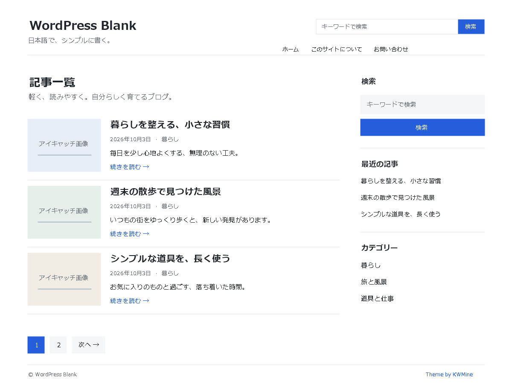

# WordPress Blank

日本語向けの軽量クラシックWordPressテーマ。**Version 1.2.6**。

[紹介](https://kwdig.com/wordpress-blank-theme) · [デモ](https://kwdig.com/wordpress-blank-theme/demo/) · [インストール用ZIP](https://github.com/kwdig/wordpress-blank-theme/releases/download/v1.2.4/wordpress-blank.zip)

## 特徴

- PCは本文と右サイドバーの2カラム、スマートフォンは1カラム
- 外部フォントを使わない日本語向けの文字組み
- アイキャッチ付き記事一覧、ページネーション、前後の記事へのナビゲーション
- タイトル直下に日付・カテゴリー・タグを表示
- ヘッダー検索、横一列のサイドバー検索、ウィジェット
- 固定ページへのリンク、ロゴ・メニュー・コメント、ブロックエディター対応
- PHP/CSSを編集してカスタマイズしやすい構成

## インストール

1. [リリースページ](https://github.com/kwdig/wordpress-blank-theme/releases/latest)から **wordpress-blank.zip** をダウンロード。
2. WordPress管理画面の「外観 → テーマ → 新しいテーマを追加 → テーマのアップロード」でZIPを選ぶ。
3. WordPress Blankを有効化し、サイト名・カテゴリー・メニュー・ウィジェットを設定。

マルチサイトではネットワーク管理からインストールしてください。GitHubの「Code → Download ZIP」はリポジトリ全体のZIPです。テーマのインストールにはリリースに添付した **wordpress-blank.zip** を使用してください。デモ記事やデモ画像は含みません。

## 動作要件

WordPress 6.0以上 / PHP 7.4以上。クラシックテーマ。投稿・固定ページのブロックエディターに対応します。

## 更新履歴

- **1.2.6**: メニュー操作用JavaScriptにdeferを追加し、HTML解析を妨げない遅延実行に変更。

- **1.2.5**: 容量が大きいカード用WebP画像のみ圧縮を追加調整。元画像を維持し、既存画像はサムネイル再生成で適用。

- **1.2.4**: 記事カード用180・360・672px画像とWebP圧縮、テーマアセットのキャッシュ設定を追加。

- **1.2.3**: 記事一覧・記事詳細のカテゴリーとタグをタイトル直下へ配置。サイドバー検索を横一列に修正。
- **1.2.2**: サイドバーに固定ページのリンクを自動表示。
- **1.2.1**: 記事詳細で画像が二重に表示される問題を修正。

詳細な仕様や変更履歴は[README.txt](README.txt)と[紹介記事](https://kwdig.com/wordpress-blank-theme)を参照してください。

## ライセンス

GPL-2.0-or-later。元テーマの制作クレジットはKWMineです。テーマ内のクレジットとライセンス表記を維持しています。

既存画像に新しいサイズを適用する場合は、サムネイルを再生成してください。画像ファイル自体のキャッシュ期間や検索エンジンへの公開は、サイト・サーバー側の設定です。
